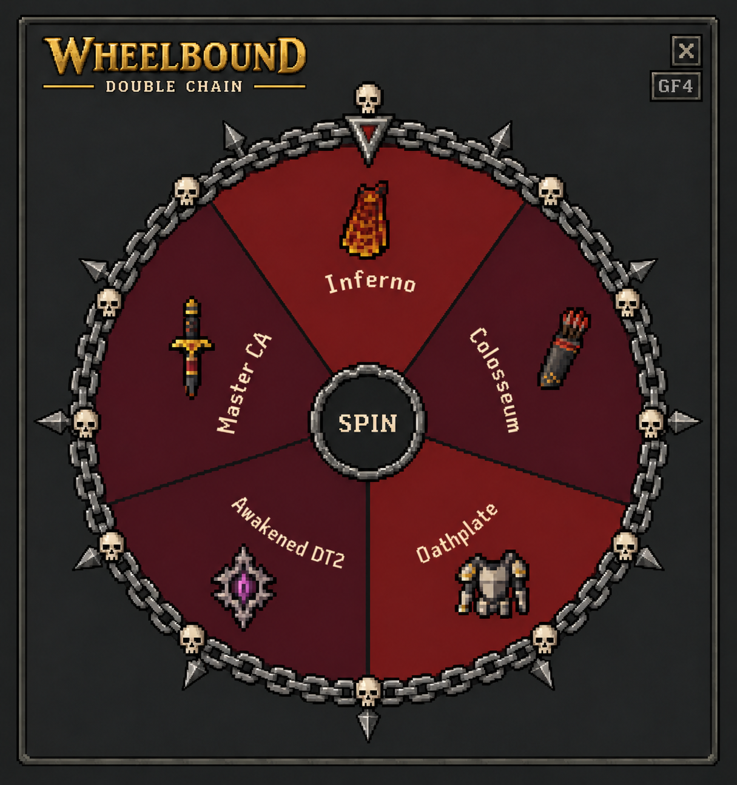

# Grand Fate — selected GF4 style

Selected by the user2026-10-16 America/Chicago; WB-D156. **Current visual baseline, adjustable later.** This original image is a concept reference, not a screenshot of implemented Wheelbound or a shipping asset.

## Locked visual direction

- The simpler existing-plugin/OSRS-like treatment: charcoal panel, modest pixel-style icons, readable labels and central SPIN button.
- Muted red/burgundy Grand Fate slices.
- GF4 iron-gray chain-ring treatment replaces the gold outer wheel circle.
- Small skulls replace perimeter iron studs; outward metal spikes surround the rim.
- Keep the five approved Grand goals and equal selection odds; the reference does not authorize different goals/odds or baked label positioning.
- Only Grand Fate is selected. Other wheel designs remain open. Taint is its own special slice, not an ordinary activity recolored into a tainted task (WB-D157).

The reference is1215×1295 PNG,1,666,269 bytes. SHA256:845c1d815fa388039de1cde62355f7ea2724269344e05430a9cca0eca47c2cf7. Preserve these original bytes for provenance. It was AI-generated from the earlier simpler Grand mockup, informed by the plugin's existing classic-wheel/header artwork and WheelStyle.java rendering anatomy. Generated item depictions/text are not exact game assets.

## RuneLite requirements checked2026-10-16

Primary source: [official Plugin Hub README](https://github.com/runelite/plugin-hub#creating-new-plugins), sections Creating new plugins and Plugin resources; checked directly during this checkpoint.

| Verified guidance | Application here |
| --- | --- |
| Optional Hub listing icon is repository-root icon.png, no larger than48×72px. | This limit concerns the listing icon. It does not turn this full-size documentation reference into a valid listing icon or impose48×72 on every runtime image. Existing root icon.png stays unchanged. |
| Plugin image/sound resources can be bundled in src/main/resources. | Future small production decorations can be bundled there; this design PNG remains under docs and is not added to the runtime resource path. |
| Resources are distributed inside JARs; prefer getResourceAsStream rather than assuming unpacked files or treating resource URLs as filesystem paths. | Maintain classpath-compatible loading and verify packaged-JAR behavior during authorized engineering. |

These verified statements do not establish universal PNG dimension/file-size limits for every overlay, a blanket AI-art policy, or approval of this specific asset. Do not invent those rules or claim RuneLite approved GF4. Original game artwork ownership remains subject to existing project notices; preserve asset provenance and review final asset rights as part of normal packaging.

## Engineering recommendations — separate from Hub rules

Use this image as a visual specification. Rebuild the wheel with dynamic geometry and labels, valid item/sprite providers and separate small transparent chain/skull/spike decorations or native rendering. Preserve sharp pixel edges where appropriate, correct transparency and modest memory/package size. Keep the pointer stationary while the selected wheel rotates; decoration layering must not imply incorrect odds or obscure labels/hit targets. The concept's GF4 badge, subtitle and close decoration are not mandatory runtime UI.

Check readability at the existing roughly209×224 sidebar component and the larger popup, including dense ordinary pools where relevant. Test scaling, alpha edges, clipping outside the chain/spikes, hover/disabled/spinning states, hit areas, performance and packaged resources. These are implementation acceptance recommendations, not new numerical Hub limits or proof of actual client tests. No production changes or tests are claimed by selecting the style.
