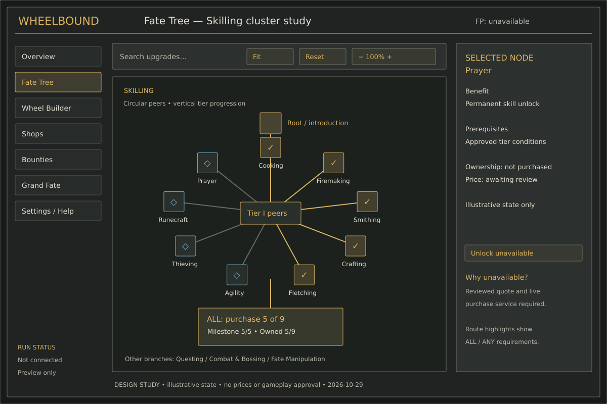
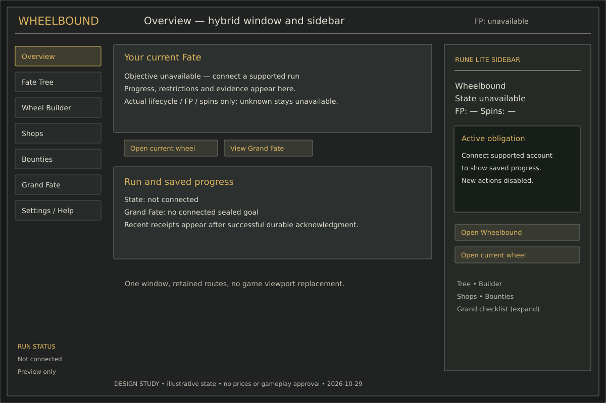

# Proposed visual review boards

Static SVG layouts, rendered and inspected as PNGs during this assignment. No new image assets, gameplay nodes, prices or approvals. Styling maps directly to Swing/Java2D geometry; these are not screenshots of the plugin. Text/icons are schematic, actual runtime sprites/fonts come from approved providers.

| Board | Scope |
| --- | --- |
| [Fate Tree](fate-tree.svg) | fate tree layout family |
| [Hub Overview](hub-overview.svg) | hub overview layout family |
| [Wheel Builder](wheel-builder.svg) | wheel builder layout family |
| [Fate Offers](fate-offers.svg) | fate offers layout family |
| [Objective Detail](objective-detail.svg) | objective detail layout family |
| [Grand Fate](grand-fate.svg) | grand fate layout family |
| [Shops Bounties](shops-bounties.svg) | shops bounties layout family |
| [Challenge Ranks](challenge-ranks.svg) | challenge ranks layout family |
| [Risk Recovery](risk-recovery.svg) | risk recovery layout family |
| [Settings Help](settings-help.svg) | settings help layout family |

Each layout's interactions/components/implementation tasks are in ../UI_SCREEN_INVENTORY.md and ../UI_IMPLEMENTATION_BACKLOG.md. Review status is tracked in ../UI_REVIEW_CHECKPOINTS.md. Fate Tree shows only the approved Tier-I cluster subset with illustrative five purchased nodes, not the missing full production catalog. Four-branch/global tree composition remains subject to actual catalog layout review. Final new Taint/Punishment wheel artwork and connected-client screenshots remain outstanding. Existing Master needs no redesign; GF4 original is preserved, B3 uses its selected text spec because the original PNG is absent from the repo.

## First review: Fate Tree

## Hybrid Hub and sidebar

